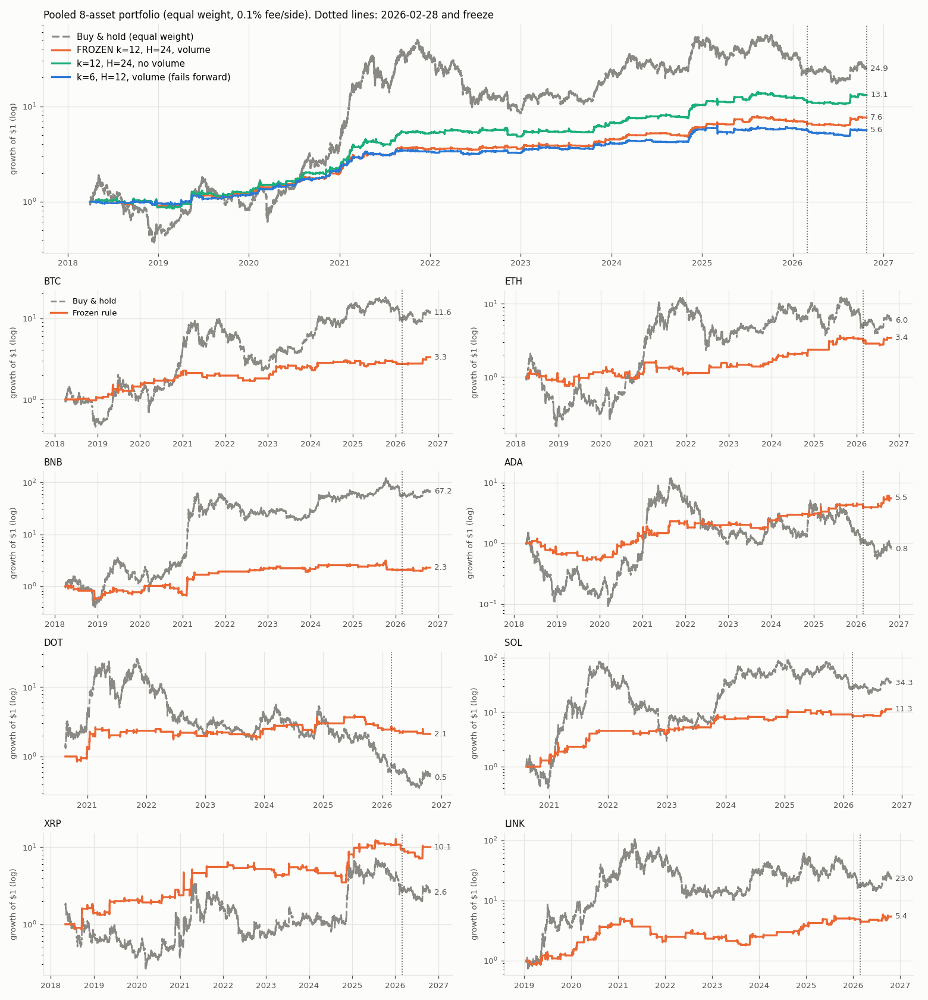
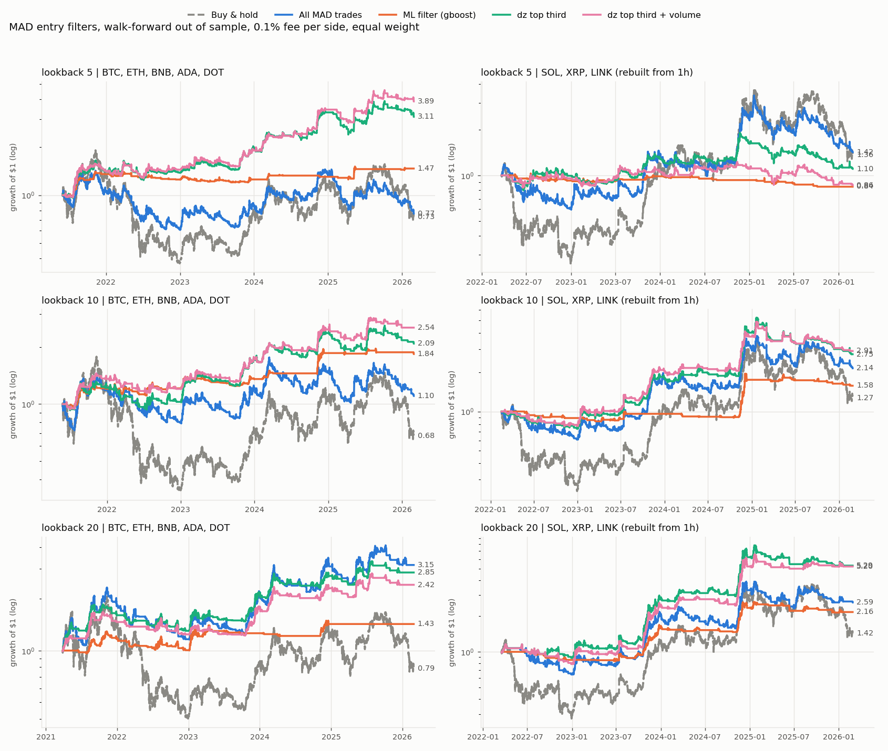

# MAD_BTC

Research on whether the Moving Average Distance (MAD) signal, and signals built on the same ideas, can give a robust
crypto trading strategy. Data: Binance spot, 4-hour bars, 8 coins (BTC, ETH, BNB, ADA, DOT, SOL, XRP, LINK), to October 2026.

**Everything here is backtested research, not investment advice.** Full write-up: [report/2026-10-25/mad_btc_report.pdf](report/2026-10-25/mad_btc_report.pdf).
Chronological log with all numbers: [RESEARCH_LOG.md](RESEARCH_LOG.md).

## Where the project stands

| Question | Answer |
|---|---|
| Is MAD a standalone strategy? | **No.** Plain, neutral-band, ADX-gated and vol-normalised versions all fail the Deflated Sharpe test (best 0.36 vs 0.95). |
| Does an ML filter on MAD trades help? | **Not reliably.** Best Deflated Sharpe 0.20; a one-parameter `dz` rule matches the model but is unstable across lookbacks. |
| Is there a signal elsewhere? | **Possibly:** a MAD-free volatility-scaled breakout (k=12 bars, z>2, 24-bar hold) beats random entries on all 8 coins. Pooled CAGR 35% vs 33% for BTC buy-and-hold, max drawdown -26% vs -77%, invested ~13% of the time. Borderline Deflated Sharpe (0.90-0.96 at 100-300 trials). |
| Is it validated? | **No.** Frozen on 2026-10-25 (`frozen_breakout.py`) with a pre-registered verdict at 100 forward trades (~20 months). Status: watch-only. |

## Results at a glance

**The breakout rule against buy-and-hold** (growth of $1, log scale, 0.1% fee per side, equal weight over 8 coins). Orange is the frozen rule
(k=12, 24-bar hold, volume spike); green is the same rule without the volume filter. The rule is invested about 10-13% of the time, so its
curve is flat for long stretches, loses far less in bear years (2018, 2022, 2025) and lags in bull years.



**The MAD filters** (what the closed MAD study led to): MAD trades filtered by gradient boosting or by the `dz` rule, lookbacks 5, 10 and 20,
original coins (left) and SOL, XRP, LINK (right). The filters help in some cells and hurt in others, which is why none of them passes the
Deflated Sharpe test.



Per-coin CAGR, Sharpe and drawdown tables are in the [report](report/2026-10-25/mad_btc_report.pdf).

## Layout

```
src/
  meta_labeling/        current research (validation, breakout, frozen rule); results/ holds its outputs
  strategy/             MAD indicators
  strategy_utils/       strategy classes and simulator
  backtesting/          older backtests of the MAD strategies
  analysis/             older plots of the MAD parameter studies
  configs/, utils/      configs and helpers
  multi_optimiser_momentum_strategy.py   Optuna + walk-forward optimiser; contains deflated_sharpe_ratio
report/2026-10-25/      LaTeX report (tex, tables, figures, pdf); build_tables.py regenerates the tables
data/                   OHLCV pickles (git-ignored; fetch_klines.py appends new bars)
RESEARCH_LOG.md         full log
```

## Run

```bash
python -m venv .venv && source .venv/bin/activate && pip install -r requirements.txt
cd src/meta_labeling
python fetch_klines.py BTCUSDT ETHUSDT BNBUSDT ADAUSDT DOTUSDT SOLUSDT XRPUSDT LINKUSDT   # append new 4h bars
python run_breakout.py            # 12-variant breakout grid       -> results/breakout.csv
python run_breakout_checks.py     # robustness and forward window
python run_ensemble.py            # lookback ensemble, exposure-matched benchmarks
python frozen_breakout.py         # score ONLY entries after the freeze; appends to results/frozen_breakout_history.csv
cd ../../report/2026-10-25 && python build_tables.py && latexmk -pdf mad_btc_report.tex
```

Scripts are described in the report (section "How to reproduce"). `results/frozen_breakout.json` is the frozen rule and its
pre-registered verdict: do not edit it. `frozen_breakout.py` warns if the hashed code changes.

## History

The project began as an implementation of "Moving Average Distance as a Predictor of Equity Returns" (Avramov, Kaplanski,
Subrahmanyam) applied to crypto. It was closed as a negative result on 2026-06-06 and reopened on 2026-10-25 for the
meta-labeling and breakout studies. An abandoned neural classifier (`classifier_ai`, TSMixer) and the experiment files it
used were removed in the 2026-10-25 cleanup; they are in git history before that commit.
